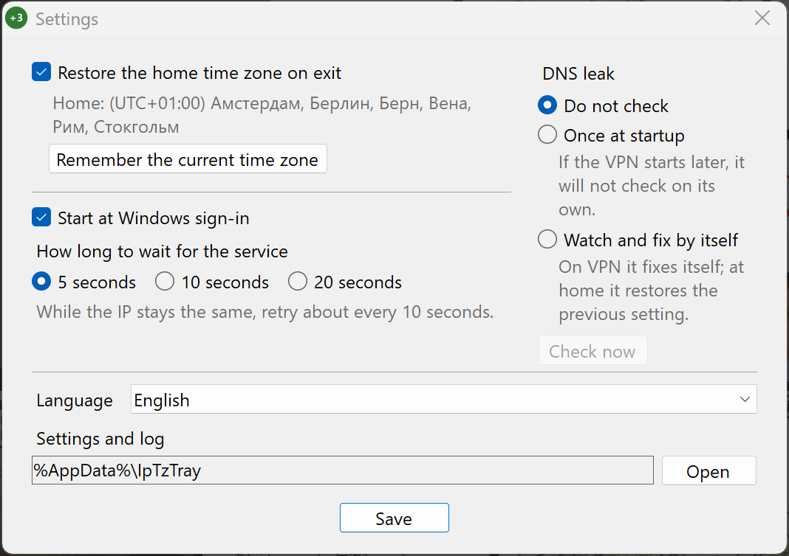

[English](README.md) · [中文](README.zh.md) · [हिन्दी](README.hi.md) · [Español](README.es.md) · **العربية** · [Français](README.fr.md) · [বাংলা](README.bn.md) · [Português](README.pt.md) · [Русский](README.ru.md) · [Bahasa Indonesia](README.id.md)

<div dir="rtl">

# IPTzTray

**المنطقة الزمنية في Windows وDNS حسب IP العام، حتى مع تشغيل VPN.**

الاسم: IP + Tz (time zone، المنطقة الزمنية) + Tray (علبة النظام في Windows).

## باختصار

يضبط IPTzTray المنطقة الزمنية في Windows حسب IP العام، أي العنوان الذي تخرج منه حركة البيانات فعلاً. عند تشغيل VPN من بلد آخر تتحول المنطقة الزمنية إلى بلد الخروج. وعند العودة إلى IP المنزل تعود المنطقة الزمنية المنزلية. ويمكن للبرنامج أيضاً، عند الطلب، أن يسد تسرب DNS خارج النفق، وهو ما يسمح لمزود الخدمة برؤية أسماء المواقع أثناء تشغيل VPN.

تتغير المنطقة الزمنية فقط، أما الساعة نفسها (توقيت UTC) فلا تُحرَّك. تعرض الشاشة وقتاً محلياً آخر، وتعرض المواقع والبرامج والخدمات الوقت نفسه.

اختيارياً، وهذا معطّل، يضبط البرنامج أيضاً بلد Windows حسب بلد IP ويعيد بلدك عند إيقاف هذا الضبط. لا تتغير لغة الواجهة ولا منطقة حساب Microsoft.

بهذا يزيل البرنامج علامتين واضحتين على استخدام VPN: وقت محلي لا يطابق IP، واستعلامات DNS تمر خارج النفق. أما العلامات الأخرى، مثل IP مركز البيانات أو لغة النظام، فلا يمسها.

يرى البرنامج IP النظام كله. أما الوكيل (proxy) المضبوط في المتصفح فقط فلا يلاحظه.

مجاني لأي استخدام. شروط النسخ المشتقة (fork) في قسم «الترخيص والاسم».

## لماذا

- المواقع والبرامج والخدمات تعرض وقت المنزل، مع أن حركة البيانات تخرج من بلد آخر.
- أُطفئ VPN، لكن المنطقة الزمنية بقيت أجنبية.
- يضبط Windows المنطقة الزمنية حسب أقرب شبكة Wi‑Fi، لا حسب IP الذي تمر منه حركة البيانات.
- مع تشغيل VPN يواصل Windows سؤال DNS الخاص بالموجّه. يخرج الطلب خارج النفق، فيرى المزود أسماء المواقع.

تُحل النقاط الثلاث الأولى بضبط المنطقة الزمنية، والرابعة بالحماية من تسرب DNS.

- من المحتمل أن يساعد ذلك في تجنّب حظر حسابات Claude (Anthropic) وغيرها من شركات تطوير الوكلاء بالذكاء الاصطناعي.

## البدء

Windows 10 أو 11، 64 بت. لا حاجة إلى التثبيت: البرنامج ملف واحد، [IpTzTray.exe](https://github.com/kubsite1/iptztray/releases/latest/download/IpTzTray.exe)، بحجم لا يتجاوز 250 KB. كل الإصدارات في صفحة [Releases](https://github.com/kubsite1/iptztray/releases).

1. نزّل `IpTzTray.exe` وشغّله.
2. اسمح بصلاحيات المسؤول: من دونها لا يسمح Windows بتغيير المنطقة الزمنية.
3. تظهر أيقونة في علبة النظام، وبعدها تُضبط المنطقة الزمنية تلقائياً.

عند التشغيل الأول يحفظ البرنامج المنطقة الزمنية الحالية على أنها المنطقة المنزلية، ويفعّل تشغيله التلقائي عند تسجيل الدخول إلى Windows. وفي كل تشغيل بصلاحيات المسؤول يوقف الضبط التلقائي للمنطقة الزمنية في Windows (خدمة `tzautoupdate`)، وإلا ضبط Windows المنطقة الزمنية حسب أقرب Wi‑Fi واختلفت قيمتها عن قيمة البرنامج.

إذا رفضت منح الصلاحيات، تظهر الأيقونة لكن المنطقة الزمنية لا تتغير. ويبقى في القائمة «التشغيل كمسؤول».

عند الخروج من البرنامج وعند انتهاء جلسة Windows (تسجيل الخروج أو إيقاف التشغيل) تعود المنطقة الزمنية المنزلية، حتى لو كان التبديل التلقائي متوقفاً. يمكن إيقاف ذلك من الإعدادات.

## الأيقونة

تعرض الأيقونة فرق المنطقة الزمنية الحالية في Windows: `+3`، `-5`، `+5:30`.

<p>


</p>

- **أخضر** — المنطقة الزمنية في Windows تطابق المنطقة الزمنية لـ IP.
- **برتقالي** — لا تطابقها: VPN يعمل لكن المنطقة الزمنية ما زالت القديمة، أو التبديل التلقائي متوقف.
- **رمادي** — لم يُفحص IP بعد.
- **أحمر** — تعذرت معرفة IP أو المنطقة الزمنية. لا تتغير المنطقة الزمنية.

النقر المزدوج على الأيقونة يفحص الآن. لا تبدأ نسخة ثانية من البرنامج: تبقى الأولى في علبة النظام.

## تسرب DNS

الفحص متوقف افتراضياً، ويُفعَّل من الإعدادات.

يتحقق البرنامج مما إذا كان Windows يسأل DNS ليس عبر النفق فقط، بل أيضاً عبر محول آخر يعمل، وغالباً ما يكون الموجّه. المحولات الافتراضية وBluetooth وTAP لا تدخل في الفحص. الفحص طلب واحد لاسم عشوائي `.invalid` يُرسل إلى ذلك الـ DNS. إذا أجاب بينما الاستعلام المتوازي عن DNS يعمل في Windows، فقد تخرج أسماء المواقع خارج VPN.


عند اكتشاف تسرب يعرض البرنامج هذه النافذة. إغلاق النافذة و«ليس الآن» لا يغيران شيئاً. أما «إصلاح» فيقوم بما يلي طوال تشغيل VPN:

- يوقف الاستعلام المتوازي عن DNS في Windows؛
- يحفظ DNS المحول الجانبي ويضع مكانه DNS النفق؛
- يحجب الطلبات الصادرة إلى DNS القديم وإلى خوادم DNS العامة المعروفة، بما فيها DNS-over-TLS وDNS-over-HTTPS؛
- يوجّه كل الأسماء إلى DNS النفق.

على الشبكة المنزلية يعود كل شيء كما كان.

الأوضاع:

- **لا تتحقق** — يزيل الحماية المفعّلة ويعيد الإعدادات السابقة.
- **مرة عند التشغيل** — يسأل فقط إذا كان هناك تسرب في تلك اللحظة. VPN الذي يُشغَّل لاحقاً لا يُفحص تلقائياً.
- **راقب وأصلح من نفسه** — يصلح دون سؤال عند كل تشغيل لـ VPN، ويعيد الإعدادات في المنزل.

لهذه الميزة يُعدّ VPN مشغّلاً عندما يمر المسار الرئيسي عبر محول نفق أو WireGuard أو Amnezia أو TAP. تبديل المنطقة الزمنية لا يعتمد على ذلك: فهو ينظر إلى IP العام فقط. إذا لم يشبه محول VPN أياً من هذه، تتبدل المنطقة الزمنية رغم ذلك، لكن قد لا يصلح البرنامج DNS من تلقاء نفسه.

بعد الإصلاح يعيد البرنامج تشغيل خدمة DNS. إذا انقطع الإنترنت فأعد تشغيل الحاسوب. أحياناً لا يسري التغيير إلا بعد إعادة التشغيل.

قد يُظهر اختبار تسرب خارجي DNS الخاص بـ VPN نفسه، مثل Cloudflare في بلد الخروج. هذا DNS النفق، لا الموجّه المنزلي.

## مرجع

### القائمة


ثلاثة أسطر رمادية في الأعلى: المكان، وIP مع اسم المنطقة الزمنية حسب IANA، والمنطقة الزمنية الحالية في Windows. إذا لم تطابق المنطقة الزمنية الحالية منطقة IP، يعرض السطر الثالث الاثنتين. السطر الطويل يُقص، والنص الكامل في التلميح.

- **تحقق الآن** — فحص إضافي فوري لـ IP.
- **إيقاف التبديل التلقائي** — يستمر الفحص ولا تتغير المنطقة الزمنية. «متابعة التبديل التلقائي» يلغي الإيقاف ويضبط المنطقة الزمنية فوراً.
- **إرجاع المنطقة المنزلية** — يضع المنطقة الزمنية المنزلية المحفوظة ويفعّل الإيقاف، وإلا غيّرها فحص IP التالي فوراً.
- **إلغاء التثبيت** — يظهر فقط إذا كان لـ IP الحالي تثبيت (انظر «الإعدادات»).
- **إصلاح تسرب DNS** — يظهر فقط إذا اكتُشف تسرب.
- **التشغيل كمسؤول** — يظهر فقط عند غياب صلاحيات المسؤول.
- **نسخ IP** — ينسخ IP العام إلى الحافظة.
- **الإعدادات**، **حول البرنامج**، **خروج**.

### الإعدادات



- **عند الخروج أرجع المنطقة المنزلية** — مفعّل افتراضياً.
- **تذكر المنطقة الحالية** — يجعل المنطقة الزمنية الحالية منزلية فوراً ويحفظ بلد Windows الحالي.
- **غيّر البلد حسب IP** — معطّل. يضبط بلد Windows حسب بلد IP العام. لا حاجة لصلاحيات المسؤول.
- **عند الإيقاف أو التبديل أرجع بلدك** — مفعّل. يعود بلدك عند إلغاء التحديد، وعند الإيقاف المؤقت، ومع «إرجاع المنطقة المنزلية»، وعند الخروج.
- **ابدأ عند تسجيل الدخول إلى Windows** — مهمة في «جدولة المهام» باسم `IpTzTray` بصلاحيات المسؤول، دون طلب الصلاحيات مرة أخرى. إلغاء التحديد يحذف المهمة.
- **كم ننتظر رد الخدمة** — 5 أو 10 أو 20 ثانية، والافتراضي 5. هذا حد كل خطوة: منفصل لفحص IP ولطلب المنطقة الزمنية.
- **تسرب DNS** — الأوضاع الثلاثة من قسم «تسرب DNS».
- **اللغة** — افتراضياً لغة Windows. إن لم تكن في القائمة فالإنجليزية. «حفظ» يطبق اللغة فوراً دون إعادة تشغيل.

لغات الواجهة: English، 中文، हिन्दी، Español، العربية، Français، বাংলা، Português، Русский، Bahasa Indonesia. أسماء المناطق الزمنية يعرضها Windows، لذلك تظهر بلغة النظام. الواجهة العربية تبقى من اليسار إلى اليمين.

أسفل النافذة مسار المجلد `%AppData%\IpTzTray` وزر «فتح». في المجلد `settings.json` والسجل `log.txt`. يُكتب السجل بالروسية. عندما يكبر الملف يُحفظ الجزء السابق في `log.txt.old`.

**التثبيت** — منطقة زمنية تختارها لعنوان IP محدد. ما دام موجوداً، يضع البرنامج تلك المنطقة الزمنية لهذا IP ولا يسأل خدمة تحديد الموقع. لا توجد في هذا الإصدار نافذة للتثبيت. يمكن كتابته في `settings.json` والبرنامج مغلق، في الحقل `Pins`:

</div>

```json
"Pins": { "203.0.113.10": "Eastern Standard Time" }
```

<div dir="rtl">

تُكتب المنطقة الزمنية باسمها في Windows. يعرض الأمر `tzutil /l` قائمة الأسماء.

### سطر الأوامر

- `IpTzTray.exe --check` — يطبع IP والمنطقة الزمنية، ولا يغير شيئاً.
- `IpTzTray.exe --dns` — يطبع هل يظهر تسرب DNS، ولا يغير شيئاً.
- `IpTzTray.exe --dry` — علبة النظام في وضع المعاينة: لا تتغير المنطقة الزمنية ولا DNS، وتُكتب الإعدادات في مجلد مؤقت.
- `IpTzTray.exe --map Europe/Amsterdam` — يطبع المنطقة الزمنية في Windows لاسم IANA.
- `IpTzTray.exe --selftest` — يفحص جدول المناطق الزمنية وقراءة الردود وحفظ الإعدادات، ولا يغير النظام.

## كيف يعمل

- **IP العام** يُطلب في الوقت نفسه من ثلاث خدمات: Cloudflare (`1.1.1.1`) وipinfo.io وip-api.com. يُعتمد العنوان الذي ذكرته خدمتان على الأقل. لا يُقبل رد خدمة واحدة إلا إذا صمتت البقية. إذا اختلفت الردود يُعاد الفحص. تُستبعد العناوين الخاصة.
- **التكرار**: ما دام IP نفسه، فحص كل 10 ثوانٍ تقريباً. بعد تغيّر الشبكة يكون الفحص الأول بعد 5 ثوانٍ، ثم كل 5 ثوانٍ لنحو 25 ثانية، ثم كل 10 ثوانٍ من جديد.
- **المنطقة الزمنية** تُطلب بالترتيب من ip-api.com وipwho.is وipinfo.io وgeojs.io، فقط عند تغيّر IP. يُحوَّل اسم IANA إلى منطقة زمنية في Windows بجدول Unicode CLDR وتُضبط بالأمر `tzutil`.
- **المنطقة الزمنية المنزلية** — منطقة Windows عند التشغيل الأول، قبل أول ضبط. إذا كانت منطقة أجنبية مضبوطة حينها، فهي التي تُحفظ. تُصحَّح بزر «تذكر المنطقة الحالية».
- **بلدك** — بلد Windows عند التشغيل الأول. الزر نفسه يحدّثه أيضاً.
- **ما يخرج إلى الخارج**: ترى خدمات معرفة IP عنوانك العام في كل فحص. ولا تستلم خدمة تحديد الموقع IP إلا عند تغيّر العنوان.

## القيود

- لا يلاحظ البرنامج الوكيل المضبوط في المتصفح فقط: فهو يرى IP النظام كله.
- مدينة مركز بيانات VPN في قاعدة تحديد الموقع لا تطابق أحياناً المنطقة الزمنية الصحيحة. تُضبط المنطقة الزمنية التي أعادتها الخدمة.
- بلا صلاحيات المسؤول لا تتغير المنطقة الزمنية ولا DNS. بلد Windows يمكن أن يتغير رغم ذلك.
- منطقة حساب Microsoft لا تتغير. عنوان IP المُثبَّت بلا رمز بلد، لذلك لا يغيّر البرنامج البلد له.

## البناء

C#، وWindows Forms، و.NET Framework المرفق مع Windows، وx64. لا يلزم إلا المترجم `csc`، وهو يأتي مع Windows. لا حاجة إلى Visual Studio.

</div>

```
powershell -ExecutionPolicy Bypass -File .\build.ps1
```

<div dir="rtl">

الناتج: `publish\IpTzTray.exe` والأيقونة `publish\app.ico`.

- `src` — الشيفرة المصدرية.
- `data/windowsZones.xml` — جدول المناطق الزمنية من Unicode CLDR.
- `build.ps1` — سكربت البناء.
- `app.manifest` — ملف بيان Windows.

كُتب البرنامج وبُني بمساعدة Grok 4.7.

## الترخيص والاسم

مجاني لأي استخدام، بما في ذلك الاستخدام التجاري.

للنسخ المشتقة والنسخ المعدّلة شرطان: عدم حذف اسم المؤلف، وعدم استخدام اسم IPTzTray. النص الكامل في [LICENSE](LICENSE).

المؤلف: hello@kubsite.ru  
صفحة البرنامج: https://github.com/kubsite1/iptztray

شكراً على الدعم — مُجمِّع المراسلات [wamm.chat](https://wamm.chat).

</div>
