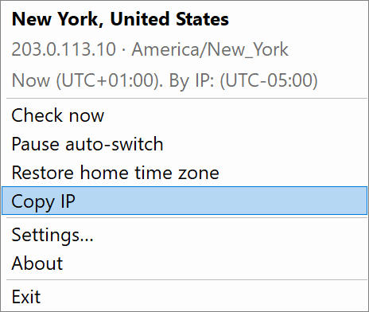

[English](README.md) · [中文](README.zh.md) · [हिन्दी](README.hi.md) · **Español** · [العربية](README.ar.md) · [Français](README.fr.md) · [বাংলা](README.bn.md) · [Português](README.pt.md) · [Русский](README.ru.md) · [Bahasa Indonesia](README.id.md)

# IPTzTray

**Huso horario de Windows y DNS según la IP pública, también con la VPN encendida.**

Nombre: IP + Tz (time zone, huso horario) + Tray (bandeja de Windows).

## En resumen

IPTzTray pone el huso horario de Windows según la IP pública: la dirección por la que realmente sale el tráfico. Al encender una VPN de otro país, el huso horario cambia al del país de salida. Al volver a la IP de casa, vuelve el huso horario de casa. Opcionalmente, el programa también cierra la fuga de DNS fuera del túnel, por la que el proveedor ve los nombres de los sitios con la VPN encendida.

Solo cambia el huso horario; el reloj en sí (la hora UTC) no se mueve. En pantalla aparece otra hora local, y la misma la muestran los sitios web, los programas y los servicios.

Opcionalmente, y está desactivado, el programa también pone el país de Windows según el país de la IP y devuelve el suyo al apagar ese ajuste. El idioma de la interfaz y la región de la cuenta de Microsoft no cambian.

Así el programa elimina dos señales visibles de una VPN: una hora local que no coincide con la IP y unas consultas DNS que salen fuera del túnel. Otras señales, como una IP de centro de datos o el idioma del sistema, no las toca.

El programa ve la IP de todo el sistema. Un proxy configurado solo en el navegador no lo detecta.

Gratis para cualquier uso. Las condiciones para forks están en «Licencia y nombre».

## Para qué

- Los sitios web, programas y servicios muestran la hora de casa aunque el tráfico ya sale desde otro país.
- La VPN está apagada, pero el huso horario sigue siendo el de fuera.
- Windows pone el huso horario según la red Wi‑Fi más cercana, no según la IP por la que pasa el tráfico.
- Con la VPN encendida, Windows sigue consultando el DNS del router. La consulta sale fuera del túnel y el proveedor ve los nombres de los sitios.

Los tres primeros puntos los resuelve el ajuste del huso horario; el cuarto, la protección contra fugas de DNS.

- Probablemente, también puede ayudar frente al bloqueo de cuentas de Claude (Anthropic) y de otros proveedores de desarrollo de agentes de IA.

## Cómo empezar

Requiere Windows 10 u 11 de 64 bits. No hay que instalar nada: el programa es un solo archivo, [IpTzTray.exe](https://github.com/kubsite1/iptztray/releases/latest/download/IpTzTray.exe), de hasta 250 KB. Todas las versiones están en la página [Releases](https://github.com/kubsite1/iptztray/releases).

1. Descargar y ejecutar `IpTzTray.exe`.
2. Conceder los permisos de administrador: sin ellos Windows no deja cambiar el huso horario.
3. Aparece un icono en la bandeja; a partir de ahí el huso horario se ajusta solo.

En el primer inicio el programa guarda el huso horario actual como el de casa y activa su propio inicio automático al entrar en Windows. En cada inicio con permisos de administrador desactiva el ajuste automático del huso horario de Windows (el servicio `tzautoupdate`); si no, Windows pone el huso horario según el Wi‑Fi más cercano y su valor no coincide con el del programa.

Si se niegan los permisos, el icono aparece, pero el huso horario no cambia. En el menú queda «Ejecutar como administrador».

Al salir del programa y al terminar la sesión de Windows (cerrar sesión o apagar), vuelve el huso horario de casa, aunque el cambio automático esté en pausa. Esto se puede desactivar en los ajustes.

## Icono

El icono muestra el desfase del huso horario actual de Windows: `+3`, `-5`, `+5:30`.

<p>


</p>

- **Verde** — el huso horario de Windows coincide con el de la IP.
- **Naranja** — no coincide: la VPN ya está encendida pero el huso horario sigue siendo el anterior, o el cambio automático está en pausa.
- **Gris** — la IP aún no se ha comprobado.
- **Rojo** — no se pudo conocer la IP o el huso horario. El huso horario no cambia.

Doble clic en el icono: comprobar ahora. Una segunda copia del programa no se inicia: en la bandeja se queda la primera.

## Fuga de DNS

Por defecto la comprobación está apagada. Se activa en los ajustes.

El programa mira si Windows consulta el DNS no solo por el túnel, sino también en otro adaptador activo, casi siempre el router. Los adaptadores virtuales, Bluetooth y TAP no entran en la comprobación. La comprobación es una consulta de un nombre aleatorio `.invalid` a ese DNS. Si responde mientras Windows tiene activada la consulta DNS en paralelo, los nombres de los sitios pueden salir fuera de la VPN.


Cuando hay una fuga, el programa muestra esta ventana. Cerrarla o pulsar «Ahora no» no cambia nada. «Corregir», mientras la VPN está encendida:

- desactiva la consulta DNS en paralelo de Windows;
- guarda el DNS del adaptador lateral y pone en su lugar el DNS del túnel;
- bloquea las consultas salientes al DNS anterior y a los DNS públicos conocidos, incluidos DNS-over-TLS y DNS-over-HTTPS;
- envía todos los nombres al DNS del túnel.

En la red de casa todo vuelve a estar como antes.

Modos:

- **No comprobar** — quita la protección ya activada y devuelve los ajustes anteriores.
- **Una vez al iniciar** — pregunta solo si hay una fuga en ese momento. Una VPN encendida después no se comprueba sola.
- **Vigilar y corregir solo** — corrige sin preguntar cada vez que se enciende la VPN y devuelve los ajustes en casa.

Para esta función, la VPN cuenta como encendida cuando la ruta principal pasa por un adaptador de túnel, WireGuard, Amnezia o TAP. El cambio de huso horario no depende de esto: solo mira la IP pública. Si el adaptador de la VPN no se parece a ninguno de estos, el huso horario cambia igualmente, pero el programa puede no corregir el DNS por sí solo.

Tras corregir, el programa reinicia el servicio DNS. Si se pierde internet, hay que reiniciar el equipo. A veces el cambio solo funciona tras reiniciar.

En una prueba de fugas externa puede seguir apareciendo el DNS de la propia VPN, por ejemplo Cloudflare en el país de salida. Ese es el DNS del túnel, no el del router de casa.

## Referencia

### Menú



Tres líneas grises arriba: lugar, IP con el nombre IANA del huso horario, huso horario actual de Windows. Si el huso horario actual no coincide con el de la IP, la tercera línea muestra los dos. Una línea larga se corta; el texto completo está en la información emergente.

- **Comprobar ahora** — una comprobación extra de la IP al momento.
- **Pausar el cambio automático** — las comprobaciones siguen, el huso horario no cambia. «Reanudar el cambio automático» quita la pausa y ajusta el huso horario enseguida.
- **Volver al huso de casa** — pone el huso horario de casa guardado y activa la pausa; si no, la siguiente comprobación de la IP lo cambiaría enseguida.
- **Quitar la fijación** — solo aparece si la IP actual tiene una fijación (ver «Ajustes»).
- **Corregir fuga de DNS** — solo aparece si ya se encontró una fuga.
- **Ejecutar como administrador** — solo aparece sin permisos de administrador.
- **Copiar IP** — copia la IP pública al portapapeles.
- **Ajustes**, **Acerca de**, **Salir**.

### Ajustes


- **Al salir, volver al huso de casa** — activado por defecto.
- **Recordar el huso actual** — convierte enseguida el huso horario actual en el de casa y recuerda el país actual de Windows.
- **Cambiar el país según la IP** — desactivado. Pone el país de Windows según el país de la IP pública. No hacen falta permisos de administrador.
- **Al apagar o cambiar, volver a su país** — activado. Su país vuelve al quitar la casilla, en pausa, con «Volver al huso de casa» y al salir.
- **Iniciar al entrar en Windows** — una tarea del Programador de tareas llamada `IpTzTray`, con permisos de administrador y sin volver a pedirlos. Al desmarcar la casilla, la tarea se borra.
- **Cuánto esperar la respuesta del servicio** — 5, 10 o 20 segundos, 5 por defecto. Es el límite de cada paso: uno para comprobar la IP y otro para pedir el huso horario.
- **Fuga de DNS** — los tres modos de la sección «Fuga de DNS».
- **Idioma** — por defecto, el idioma de Windows. Si no está en la lista, inglés. «Guardar» aplica el idioma al momento, sin reiniciar.

Idiomas de la interfaz: English, 中文, हिन्दी, Español, العربية, Français, বাংলা, Português, Русский, Bahasa Indonesia. Los nombres de los husos horarios los da Windows, así que salen en el idioma del sistema.

Abajo en la ventana: la ruta a la carpeta `%AppData%\IpTzTray` y el botón «Abrir». En la carpeta están `settings.json` y el registro `log.txt`. El registro se escribe en ruso. Cuando el archivo crece, la parte anterior se guarda en `log.txt.old`.

**Fijación** — un huso horario propio para una IP concreta. Mientras existe, el programa pone ese huso horario para esa IP y no consulta el servicio de geolocalización. Esta versión no tiene ventana para fijar. Se puede escribir en `settings.json`, con el programa cerrado, en el campo `Pins`:

```json
"Pins": { "203.0.113.10": "Eastern Standard Time" }
```

El huso horario se indica por su nombre de Windows. `tzutil /l` muestra la lista de nombres.

### Línea de comandos

- `IpTzTray.exe --check` — muestra la IP y el huso horario, no cambia nada.
- `IpTzTray.exe --dns` — muestra si se ve una fuga de DNS, no cambia nada.
- `IpTzTray.exe --dry` — bandeja en modo de vista previa: el huso horario y el DNS no cambian, los ajustes se guardan en una carpeta temporal.
- `IpTzTray.exe --map Europe/Amsterdam` — muestra el huso horario de Windows para un nombre IANA.
- `IpTzTray.exe --selftest` — comprueba la tabla de husos horarios, la lectura de respuestas y el guardado de ajustes; no cambia el sistema.

## Cómo funciona

- **IP pública**: se pregunta a la vez a tres servicios: Cloudflare (`1.1.1.1`), ipinfo.io e ip-api.com. Se toma la dirección que den al menos dos. La respuesta de un solo servicio se acepta solo si los demás no responden. Si las respuestas no coinciden, la comprobación se repite. Las direcciones privadas se descartan.
- **Frecuencia**: mientras la IP no cambia, cada 10 segundos aproximadamente. Tras un cambio de red, la primera comprobación llega a los 5 segundos, luego cada 5 segundos durante unos 25 segundos y después otra vez cada 10 segundos.
- **Huso horario**: se pregunta por orden a ip-api.com, ipwho.is, ipinfo.io y geojs.io, solo cuando cambia la IP. El nombre IANA se convierte en un huso horario de Windows con la tabla de Unicode CLDR y se pone con `tzutil`.
- **Huso horario de casa**: el huso horario de Windows en el primer inicio, antes del primer ajuste. Si entonces ya había uno de fuera, se guarda ese. Se corrige con «Recordar el huso actual».
- **Su país**: el país de Windows en el primer inicio. El mismo botón también lo actualiza.
- **Qué sale fuera**: los servicios que detectan la IP ven la IP pública en cada comprobación. El servicio de geolocalización recibe la IP solo cuando cambia la dirección.

## Limitaciones

- Un proxy configurado solo en el navegador no se detecta: el programa ve la IP de todo el sistema.
- La ciudad del centro de datos de la VPN en la base de geolocalización a veces no coincide con el huso horario correcto. Se pone el huso horario que devuelve el servicio.
- Sin permisos de administrador no cambian ni el huso horario ni el DNS. El país de Windows sí puede cambiar.
- La región de la cuenta de Microsoft no cambia. Una IP fijada no tiene código de país, así que el programa no le cambia el país.

## Compilación

C#, Windows Forms, el .NET Framework incluido en Windows, x64. Solo hace falta el compilador `csc`, que viene con Windows. No hace falta Visual Studio.

```
powershell -ExecutionPolicy Bypass -File .\build.ps1
```

Resultado: `publish\IpTzTray.exe` y el icono `publish\app.ico`.

- `src` — código fuente.
- `data/windowsZones.xml` — tabla de husos horarios de Unicode CLDR.
- `build.ps1` — script de compilación.
- `app.manifest` — manifiesto de Windows.

El programa se escribió y se compiló con Grok 4.7.

## Licencia y nombre

Gratis para cualquier uso, también comercial.

Los forks y las versiones modificadas tienen dos condiciones: no quitar la autoría y no usar el nombre IPTzTray. Texto completo en [LICENSE](LICENSE).

Autor: hello@kubsite.ru  
Página del programa: https://github.com/kubsite1/iptztray

Gracias por el apoyo del agregador de mensajería [wamm.chat](https://wamm.chat).
