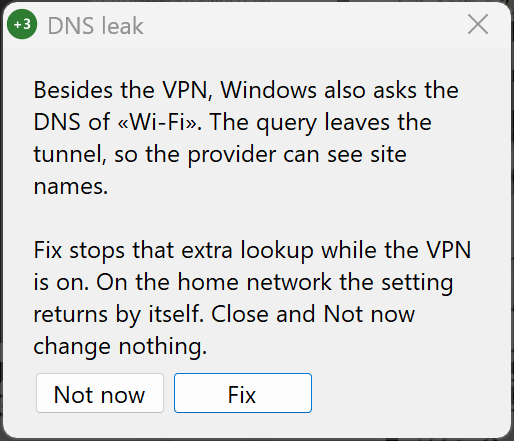

[English](README.md) · [中文](README.zh.md) · **हिन्दी** · [Español](README.es.md) · [العربية](README.ar.md) · [Français](README.fr.md) · [বাংলা](README.bn.md) · [Português](README.pt.md) · [Русский](README.ru.md) · [Bahasa Indonesia](README.id.md)

# IPTzTray

**सार्वजनिक IP के अनुसार Windows का समय क्षेत्र और DNS, VPN चालू होने पर भी।**

नाम: IP + Tz (time zone, समय क्षेत्र) + Tray (Windows ट्रे)।

## संक्षेप में

IPTzTray सार्वजनिक IP के अनुसार Windows का समय क्षेत्र सेट करता है — यानी वह पता जिससे ट्रैफ़िक असल में बाहर जाता है। किसी दूसरे देश का VPN चालू किया, तो समय क्षेत्र निकास वाले देश का हो जाता है। घर के IP पर लौटे, तो समय क्षेत्र फिर घरेलू हो जाता है। चाहें तो प्रोग्राम टनल के बाहर होने वाला DNS रिसाव भी बंद करता है, जिसकी वजह से VPN चालू होने पर भी प्रदाता साइटों के नाम देख सकता है।

सिर्फ़ समय क्षेत्र बदलता है; घड़ी ख़ुद (UTC समय) नहीं खिसकाई जाती। स्क्रीन पर दूसरा स्थानीय समय दिखता है, और साइटें, प्रोग्राम और सेवाएँ भी वही समय दिखाती हैं।

इस तरह प्रोग्राम VPN के दो साफ़ दिखने वाले संकेत हटाता है: स्थानीय समय IP से मेल नहीं खाता, और DNS अनुरोध टनल के बाहर जाते हैं। दूसरे संकेत, जैसे डेटा सेंटर का IP या सिस्टम की भाषा, यह नहीं छूता।

प्रोग्राम पूरे सिस्टम का IP देखता है। सिर्फ़ ब्राउज़र में लगाया गया प्रॉक्सी उसे नहीं दिखता।

किसी भी उपयोग के लिए मुफ़्त। फ़ोर्क की शर्तें “लाइसेंस और नाम” में हैं।

## किसलिए

- ट्रैफ़िक दूसरे देश से जा रहा है, फिर भी साइटें, प्रोग्राम और सेवाएँ घर का समय दिखाते हैं।
- VPN बंद हो गया, पर समय क्षेत्र विदेशी ही रह गया।
- Windows समय क्षेत्र पास के Wi‑Fi नेटवर्क से तय करता है, उस IP से नहीं जिससे ट्रैफ़िक जाता है।
- VPN चालू होने पर भी Windows राउटर के DNS से पूछता रहता है। अनुरोध टनल के बाहर जाता है, और प्रदाता साइटों के नाम देखता है।

पहले तीन बिंदु समय क्षेत्र के समायोजन से हल होते हैं, चौथा DNS रिसाव से सुरक्षा से।

- संभवतः यह Claude (Anthropic) और एजेंट विकास (AI) के अन्य विक्रेताओं द्वारा खाते ब्लॉक किए जाने से बचने में मदद कर सकता है।

## शुरुआत

Windows 10 या 11, 64-बिट। कुछ इंस्टॉल नहीं करना है: प्रोग्राम एक ही फ़ाइल है, [IpTzTray.exe](https://github.com/kubsite1/iptztray/releases/latest/download/IpTzTray.exe), 250 KB तक। सभी संस्करण [Releases](https://github.com/kubsite1/iptztray/releases) पेज पर हैं।

1. `IpTzTray.exe` डाउनलोड करके चलाएँ।
2. व्यवस्थापक अधिकार की अनुमति दें: इनके बिना Windows समय क्षेत्र बदलने नहीं देता।
3. ट्रे में आइकन आ जाता है; इसके बाद समय क्षेत्र अपने आप समायोजित होता है।

पहली बार चलने पर प्रोग्राम मौजूदा समय क्षेत्र को घरेलू के रूप में याद रखता है और Windows साइन-इन पर अपना ऑटोस्टार्ट चालू करता है। व्यवस्थापक अधिकार के साथ हर बार चलने पर यह Windows में समय क्षेत्र का स्वचालित निर्धारण (सेवा `tzautoupdate`) बंद करता है; नहीं तो Windows पास के Wi‑Fi से समय क्षेत्र तय करता है और उसका मान प्रोग्राम से अलग हो जाता है।

अगर अधिकार देने से मना करें, तो आइकन दिखेगा, पर समय क्षेत्र नहीं बदलेगा। मेनू में “व्यवस्थापक के रूप में चलाएँ” बना रहेगा।

प्रोग्राम से बाहर निकलने पर और Windows सत्र ख़त्म होने पर (साइन-आउट या बंद करना), घरेलू समय क्षेत्र लौट आता है, भले ही स्वतः बदलाव रुका हो। इसे सेटिंग में बंद किया जा सकता है।

## आइकन

आइकन पर Windows के मौजूदा समय क्षेत्र का अंतर दिखता है: `+3`, `-5`, `+5:30`।

<p>


</p>

- **हरा** — Windows का समय क्षेत्र IP के समय क्षेत्र से मेल खाता है।
- **नारंगी** — मेल नहीं खाता: VPN चालू हो चुका है पर समय क्षेत्र अभी पुराना है, या स्वतः बदलाव रुका हुआ है।
- **धूसर** — IP अभी जाँचा नहीं गया।
- **लाल** — IP या समय क्षेत्र पता नहीं चल सका। समय क्षेत्र नहीं बदलता।

आइकन पर डबल-क्लिक — अभी जाँचें। प्रोग्राम की दूसरी प्रति शुरू नहीं होती: ट्रे में पहली ही रहती है।

## DNS रिसाव

जाँच डिफ़ॉल्ट रूप से बंद है। इसे सेटिंग में चालू करें।

प्रोग्राम देखता है कि Windows DNS सिर्फ़ टनल से ही नहीं, किसी दूसरे चालू अडैप्टर से भी पूछता है या नहीं — अक्सर राउटर से। वर्चुअल अडैप्टर, Bluetooth और TAP जाँच में शामिल नहीं होते। जाँच इस DNS को किसी यादृच्छिक `.invalid` नाम का एक अनुरोध है। अगर Windows में समानांतर DNS पूछताछ चालू रहते यह उत्तर देता है, तो साइटों के नाम VPN के बाहर जा सकते हैं।



रिसाव मिलने पर प्रोग्राम यह विंडो दिखाता है। विंडो बंद करना और “अभी नहीं” कुछ नहीं बदलते। “ठीक करें” VPN चालू रहने तक:

- Windows में समानांतर DNS पूछताछ बंद करता है;
- दूसरे अडैप्टर का DNS याद रखता है और उसकी जगह टनल का DNS लगाता है;
- पुराने DNS और जाने-माने सार्वजनिक DNS पर जाने वाले अनुरोध रोकता है, DNS-over-TLS और DNS-over-HTTPS समेत;
- सभी नाम टनल के DNS पर भेजता है।

घर के नेटवर्क पर सब पहले जैसा हो जाता है।

मोड:

- **जाँच न करें** — पहले से चालू सुरक्षा हटाता है और पुरानी सेटिंग लौटाता है।
- **शुरू में एक बार** — सिर्फ़ तब पूछता है जब उस समय रिसाव हो। बाद में चालू हुआ VPN अपने आप नहीं जाँचा जाता।
- **खुद देखें और ठीक करें** — हर बार VPN चालू होने पर बिना पूछे ठीक करता है और घर पर सेटिंग लौटाता है।

इस सुविधा के लिए VPN तब चालू माना जाता है जब मुख्य रूट टनल अडैप्टर, WireGuard, Amnezia या TAP से जाता है। समय क्षेत्र बदलना इस पर निर्भर नहीं: वह सिर्फ़ सार्वजनिक IP देखता है। अगर VPN का अडैप्टर इनमें से किसी जैसा नहीं है, तो समय क्षेत्र फिर भी बदलेगा, पर प्रोग्राम शायद DNS ख़ुद ठीक न करे।

ठीक करने के बाद प्रोग्राम DNS सेवा फिर से शुरू करता है। अगर इंटरनेट चला जाए, तो कंप्यूटर पुनरारंभ करें। कभी-कभी बदलाव पुनरारंभ के बाद ही लागू होता है।

किसी बाहरी रिसाव टेस्ट में VPN का अपना DNS दिख सकता है, जैसे निकास वाले देश में Cloudflare। यह टनल का DNS है, घर के राउटर का नहीं।

## संदर्भ

### मेनू


ऊपर तीन धूसर पंक्तियाँ: स्थान, IANA समय क्षेत्र के नाम के साथ IP, Windows का मौजूदा समय क्षेत्र। अगर मौजूदा समय क्षेत्र IP के समय क्षेत्र से मेल नहीं खाता, तो तीसरी पंक्ति में दोनों दिखते हैं। लंबी पंक्ति कट जाती है; पूरा पाठ टूलटिप में दिखता है।

- **अभी जाँचें** — IP की तुरंत एक अतिरिक्त जाँच।
- **स्वतः बदलाव रोकें** — जाँच चलती रहती है, समय क्षेत्र नहीं बदलता। “स्वतः बदलाव जारी रखें” रोक हटाता है और तुरंत समय क्षेत्र समायोजित करता है।
- **घरेलू समय क्षेत्र लौटाएँ** — याद रखा घरेलू समय क्षेत्र लगाता है और रोक चालू करता है, नहीं तो अगली IP जाँच उसे तुरंत बदल देगी।
- **पिन हटाएँ** — सिर्फ़ तब दिखता है जब मौजूदा IP का पिन हो (देखें “सेटिंग”)।
- **DNS रिसाव ठीक करें** — सिर्फ़ तब दिखता है जब रिसाव मिल चुका हो।
- **व्यवस्थापक के रूप में चलाएँ** — सिर्फ़ तब दिखता है जब व्यवस्थापक अधिकार न हों।
- **IP कॉपी करें** — सार्वजनिक IP क्लिपबोर्ड पर कॉपी करता है।
- **सेटिंग**, **परिचय**, **बाहर जाएँ**।

### सेटिंग


- **बाहर निकलने पर घरेलू समय क्षेत्र लौटाएँ** — डिफ़ॉल्ट रूप से चालू।
- **वर्तमान समय क्षेत्र याद रखें** — मौजूदा समय क्षेत्र को तुरंत घरेलू बना देता है।
- **Windows साइन-इन पर चलाएँ** — टास्क शेड्यूलर में `IpTzTray` नाम का कार्य, व्यवस्थापक अधिकार के साथ, अधिकार दोबारा माँगे बिना। निशान हटाने पर कार्य हट जाता है।
- **सेवा के उत्तर की प्रतीक्षा कितनी देर** — 5, 10 या 20 सेकंड, डिफ़ॉल्ट 5। यह हर कदम की सीमा है: IP जाँच और समय क्षेत्र पूछने के लिए अलग-अलग।
- **DNS रिसाव** — “DNS रिसाव” भाग के तीन मोड।
- **भाषा** — डिफ़ॉल्ट रूप से Windows की भाषा। सूची में न हो तो अंग्रेज़ी। “सहेजें” भाषा तुरंत लागू करता है, पुनरारंभ के बिना।

इंटरफ़ेस की भाषाएँ: English, 中文, हिन्दी, Español, العربية, Français, বাংলা, Português, Русский, Bahasa Indonesia। समय क्षेत्रों के नाम Windows देता है, इसलिए वे सिस्टम की भाषा में होते हैं।

विंडो के नीचे `%AppData%\IpTzTray` फ़ोल्डर का पथ और “खोलें” बटन है। फ़ोल्डर में `settings.json` और लॉग `log.txt` होते हैं। लॉग रूसी में लिखा जाता है। फ़ाइल बड़ी होने पर पिछला हिस्सा `log.txt.old` में रखा जाता है।

**पिन** — किसी ख़ास IP के लिए अपना समय क्षेत्र। जब तक पिन है, प्रोग्राम उस IP के लिए वही समय क्षेत्र लगाता है और भू-स्थान सेवा से नहीं पूछता। इस संस्करण में पिन करने की विंडो नहीं है। प्रोग्राम बंद रहते इसे `settings.json` के `Pins` फ़ील्ड में लिखा जा सकता है:

```json
"Pins": { "203.0.113.10": "Eastern Standard Time" }
```

समय क्षेत्र Windows के नाम से लिखा जाता है। `tzutil /l` नामों की सूची दिखाता है।

### कमांड लाइन

- `IpTzTray.exe --check` — IP और समय क्षेत्र दिखाता है, कुछ नहीं बदलता।
- `IpTzTray.exe --dns` — दिखाता है कि DNS रिसाव दिख रहा है या नहीं, कुछ नहीं बदलता।
- `IpTzTray.exe --dry` — ट्रे पूर्वावलोकन मोड में: समय क्षेत्र और DNS नहीं बदलते, सेटिंग अस्थायी फ़ोल्डर में लिखी जाती है।
- `IpTzTray.exe --map Europe/Amsterdam` — IANA नाम के लिए Windows का समय क्षेत्र दिखाता है।
- `IpTzTray.exe --selftest` — समय क्षेत्र तालिका, उत्तरों को पढ़ना और सेटिंग सहेजना जाँचता है; सिस्टम नहीं बदलता।

## यह कैसे काम करता है

- **सार्वजनिक IP** एक साथ तीन सेवाओं से पूछा जाता है: Cloudflare (`1.1.1.1`), ipinfo.io और ip-api.com। वह पता लिया जाता है जिसे कम से कम दो ने बताया। एक सेवा का उत्तर तभी माना जाता है जब बाक़ी चुप हों। उत्तर अलग हों तो जाँच दोहराई जाती है। निजी पते छोड़ दिए जाते हैं।
- **आवृत्ति**: जब तक IP वही है, लगभग हर 10 सेकंड। नेटवर्क बदलने के बाद पहली जाँच 5 सेकंड में, फिर लगभग 25 सेकंड तक हर 5 सेकंड, फिर दोबारा हर 10 सेकंड।
- **समय क्षेत्र** बारी-बारी से ip-api.com, ipwho.is, ipinfo.io और geojs.io से पूछा जाता है, सिर्फ़ IP बदलने पर। IANA समय क्षेत्र का नाम Unicode CLDR तालिका से Windows के समय क्षेत्र में बदला जाता है और `tzutil` से लगाया जाता है।
- **घरेलू समय क्षेत्र** — पहली बार चलने पर, पहले समायोजन से पहले का Windows समय क्षेत्र। अगर तब कोई विदेशी समय क्षेत्र लगा था, तो वही याद रहेगा। इसे “वर्तमान समय क्षेत्र याद रखें” से ठीक करें।
- **क्या बाहर जाता है**: IP बताने वाली सेवाएँ हर जाँच पर आपका सार्वजनिक IP देखती हैं। भू-स्थान सेवा को IP सिर्फ़ पता बदलने पर भेजा जाता है।

## सीमाएँ

- सिर्फ़ ब्राउज़र में लगाया गया प्रॉक्सी प्रोग्राम को नहीं दिखता: वह पूरे सिस्टम का IP देखता है।
- भू-स्थान डेटाबेस में VPN डेटा सेंटर का शहर कभी-कभी सही समय क्षेत्र से मेल नहीं खाता। वही समय क्षेत्र लगता है जो सेवा ने लौटाया।
- व्यवस्थापक अधिकार के बिना न समय क्षेत्र बदलता है, न DNS।

## बिल्ड

C#, Windows Forms, Windows के साथ आने वाला .NET Framework, x64। सिर्फ़ `csc` कंपाइलर चाहिए, जो Windows के साथ आता है। Visual Studio की ज़रूरत नहीं।

```
powershell -ExecutionPolicy Bypass -File .\build.ps1
```

परिणाम: `publish\IpTzTray.exe` और आइकन `publish\app.ico`।

- `src` — स्रोत कोड।
- `data/windowsZones.xml` — Unicode CLDR की समय क्षेत्र तालिका।
- `build.ps1` — बिल्ड स्क्रिप्ट।
- `app.manifest` — Windows मैनिफ़ेस्ट।

प्रोग्राम Grok 4.7 की मदद से लिखा और बिल्ड किया गया।

## लाइसेंस और नाम

किसी भी उपयोग के लिए मुफ़्त, व्यावसायिक उपयोग समेत।

फ़ोर्क और बदले हुए बिल्ड के लिए दो शर्तें हैं: लेखक का नाम न हटाएँ और IPTzTray नाम का उपयोग न करें। पूरा पाठ [LICENSE](LICENSE) में है।

लेखक: hello@kubsite.ru  
प्रोग्राम का पेज: https://github.com/kubsite1/iptztray

समर्थन के लिए धन्यवाद — मैसेंजर एग्रीगेटर [wamm.chat](https://wamm.chat).
